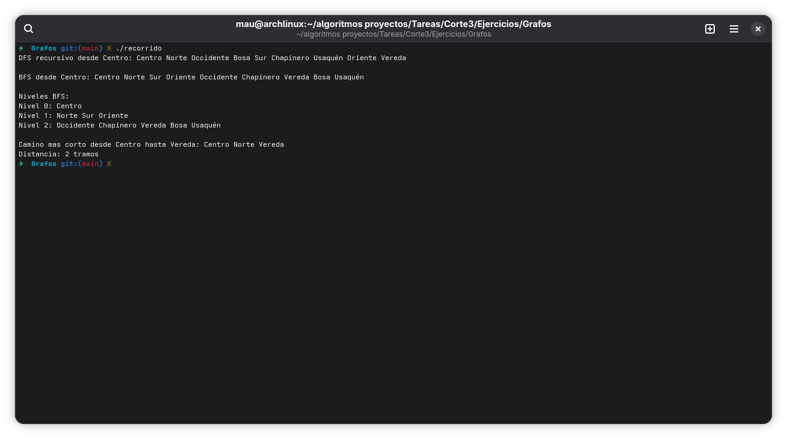

inciar desde el punto medio, e ir recorriendo, elemento por elemento de la lista, verificando su grado para evitar quedar en ciclos, y siga con el siguiente elemento o rama disponible

MARCAR LO QUE YA SE VISITÓ

//evidencia compilación y ejecución cpp:
